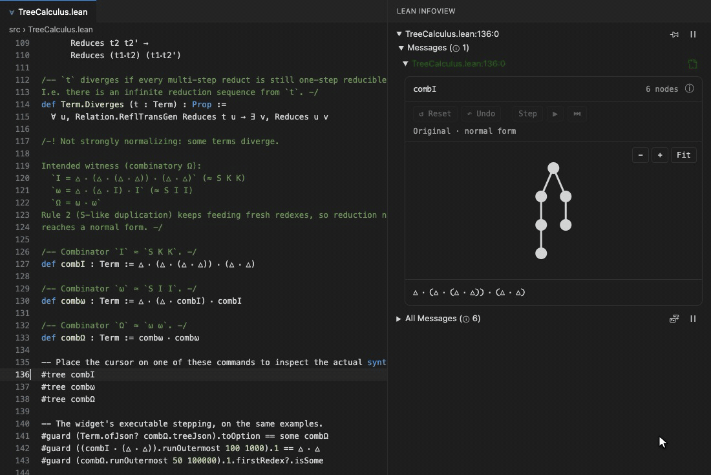

# boom 💥

Dutch for _tree_. Also: 💥.

A Lean 4 formalisation of [tree calculus](https://treecalcul.us/) — specifically the **triage** (five-rule) variant suggested by Johannes Bader and used on that site / in Barry Jay’s later work. Programs and values are unlabeled binary trees (leaf / stem / fork); the sole operator is △.

`#tree t` shows a term as an interactive tree in the Lean infoview. Orange nodes are redexes: click one to rewrite it, or step, play and run through a reduction. Every step is computed in Lean by a rewrite function proved sound against the reduction relation.



## Building

Requires the Lean toolchain pinned in `lean-toolchain` (`leanprover/lean4:v4.26.0`, managed by `elan`). On a fresh clone:

```bash
lake exe cache get   # download prebuilt Mathlib oleans (don't recompile Mathlib!)
lake build
```

## Tree Calculus representations

`Term` in `TreeCalculus.Term` is the canonical syntax representation: a node
with an ordered list of arguments, with reduction and normal forms defined
separately in `TreeCalculus.lean`. The `Value` / `ValOrRedex` presentation and
its proofs live in `TreeCalculus.ValOrRedex` (check with
`lake build TreeCalculus.ValOrRedex`). Both presentations remain available for
future comparisons and equivalence results. Their current reduction relations
differ: the `ValOrRedex` relation discards trailing arguments, so its confluence
theorem does not establish confluence for `Term`.

## References

- Barry Jay. _Reflective Programs in Tree Calculus._ (book)
- [treecalcul.us](https://treecalcul.us/) — demos and specification (Johannes Bader)
- Barry Jay. [Calculus, calculi](https://github.com/barry-jay-personal/blog/blob/main/2024-12-12-calculus-calculi.md) — original three-rule tree calculus vs triage calculus
